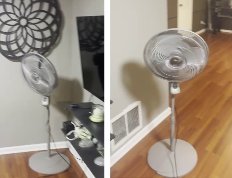
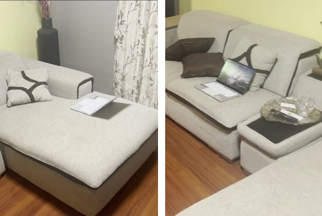
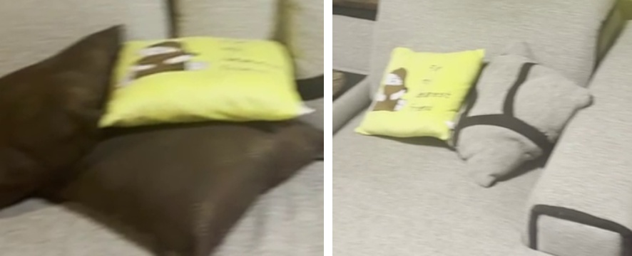
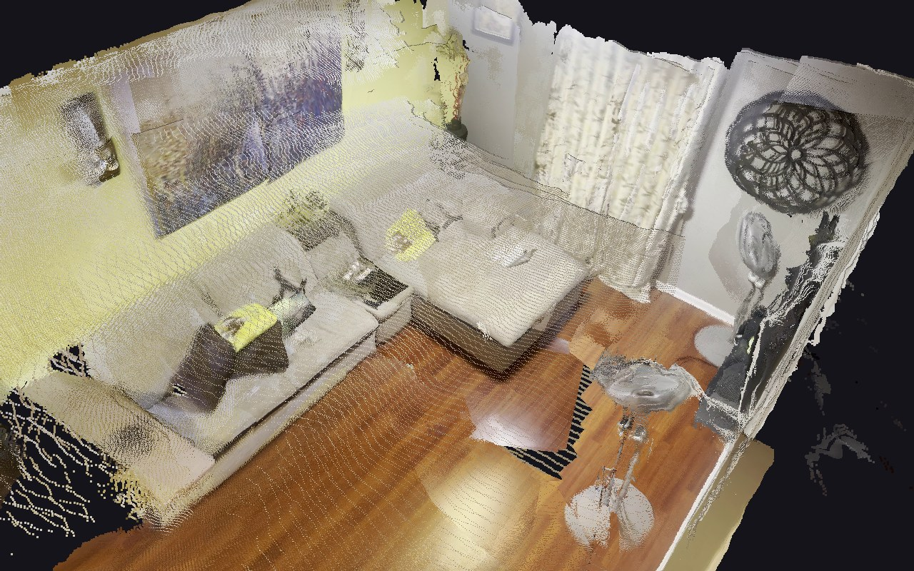

# 3D Change Detection (threedcd)

## Overview

threedcd compares two phone videos of the same room, filmed before and after some objects were moved, and reports
what changed: which objects moved, appeared, disappeared or were swapped, where each one was and where it went, and
a plain-English sentence describing each change.

How it works:

1. **One 3D model from both videos.** [VGGT-Omega](https://github.com/facebookresearch/vggt-omega), a feed-forward
   neural network built on the Visual Geometry Grounded Transformer (VGGT) architecture, predicts the camera
   position and a depth map for 40 sharp frames from each video in a single pass, which puts both videos in the
   same 3D coordinate frame.
2. **Measure the noise.** Walls and furniture that didn't change should line up between the videos; how far they
   don't (about 3 cm here) is the tolerance tau. Every later threshold is a multiple of tau, so reconstruction
   noise is not mistaken for change.
3. **Find candidate changes** with four detectors, each covering another's blind spot:
   - *Voxel space:* the room is split into 1 cm cubes, and each video labels every cube *occupied* (a camera saw a
     surface there), *free* (a camera saw through it) or *unknown* (no camera looked). Free before and occupied
     after means something was added, and the reverse means removed. Unknown in either video is never a change, so
     areas only one video saw can't produce false alarms.
   - *Depth:* each frame's depth is compared pixel by pixel with the other video's depth seen from the same
     viewpoint, after cancelling local misalignment. This catches thin objects the voxels miss.
   - *Colour:* a spot occupied in both videos but a different colour means one object replaced another.
   - *Objects:* OWLv2 finds named objects in every frame. They are placed in 3D and matched between the videos by
     label and colour; far-apart matches are moves.
4. **Verify and describe.** The candidates are merged into one list, and a vision LLM looks at before/after crops of
   each spot, keeps only real changes, merges fragments of the same move, and describes each one.

The repo includes the two recordings it was developed on (`data/raw/`: a living room where a fan, a laptop and a
pillow were moved).

## Running it

### Requirements

- An NVIDIA GPU with 8 GB or more, and Python 3.12.
- Access to the gated VGGT-Omega weights: request it at https://huggingface.co/facebook/VGGT-Omega.
- A vision-capable LLM for verification and descriptions. The code calls Claude (Anthropic API); to use another
  model, replace the request in `verify_vlm.ask` and `describe.describe`.

### Setup

```bash
git clone https://github.com/RohitKarthickeyan/threedcd.git
cd threedcd
python -m venv .venv
# Windows: .venv\Scripts\activate     Linux/macOS: source .venv/bin/activate
pip install torch torchvision --index-url https://download.pytorch.org/whl/cu128
pip install -r requirements.txt
hf auth login
```

For Claude, put your key in a `.env` file in the repo root (git-ignored): `ANTHROPIC_API_KEY=...`

### Usage

Put the two videos in `data/raw/` as `before.<ext>` and `after.<ext>` (the included recordings are already there),
then run:

```bash
python run.py
```

| Option | Effect |
|---|---|
| `--frames N` | frames per video (default 40) |
| `--no-llm` | skip verification and descriptions (no LLM needed) |
| `--no-view` | don't open the 3D viewer at the end |

Outputs go to `data/out/`, including `report.md` (the list of changes) and `change_N.jpg` (before/after images).
`data/gt.json` scores the included recordings; delete it when using your own. Tests: `python -m pytest -q`.

## What it found

Each pair shows the object's old spot in the first video (left) and its new spot in the second (right), located
automatically from the 3D model, with the LLM's description below.

**Fan**



> The gray standing fan was moved about 1.3 meters along the wall, from under the decorative wall art by the TV
> shelves to a spot beside the floor vent.

**Laptop**



> The open silver laptop that was lying on the chaise end of the grey sofa has been moved about 1.4 metres to the
> main sofa seat, next to the brown cushions.

**Pillow**



> The yellow-green cushion was lifted off the dark brown cushion and put on the sofa seat against the backrest,
> about 1.3 metres from where it was.

## The 3D reconstruction

The room rebuilt from both videos together, so each moved object appears in both places (the fan by the wall art
and again on the floor).



## Results

Scored against hand-marked ground truth (`data/gt.json`: the old and new spot of each object, 6 spots):

| Version | Changes reported | Spots found | False alarms |
|---|---|---|---|
| 3D free-space comparison only | 28 | 4 / 6 | 24 |
| All four detectors + LLM verification | 13 | 6 / 6 | 5 |
| + merging fragments into moves (current) | 3 | 6 / 6 | 0 |

## Design decisions and tradeoffs

- **VGGT-Omega instead of COLMAP.** COLMAP struggles with blurry phone video and blank walls, gives sparse points
  unless you run slow dense stereo, and would reconstruct each video separately, so they would need registering.
  VGGT-Omega gives dense depth for both videos in one coordinate frame in seconds. Its scale is arbitrary, which
  is why thresholds are relative to the measured alignment error.
- **Not Gaussian splatting or NeRFs.** They need camera poses first, train per scene, and fill unseen space with
  plausible guesses. Change detection depends on telling *empty* (seen through) apart from *never seen*, which
  they blur. They would suit a nicer demo, not detection.
- **Not panorama stitching or 2D image differencing.** Stitching assumes the camera only rotates, but walked
  videos have parallax that shows up as false change. 2D also can't say where an object went or tell "removed"
  from "hidden".
- **Several detectors plus an LLM.** No single signal caught all three changes: the free-space check misses the
  laptop, whose reclined lid sits within ~3 cm of the cushion, but the depth and object detectors catch it. The
  detectors are tuned to miss nothing; the LLM removes their false alarms.
- **Tried and dropped.** DINOv2 features (noisier than plain colour here), matching objects by label alone (missed
  the pillow, which swapped places with other pillows), and dilating the unknown region (erased every change).
